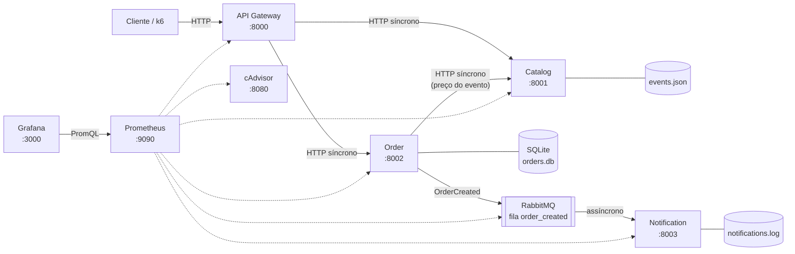
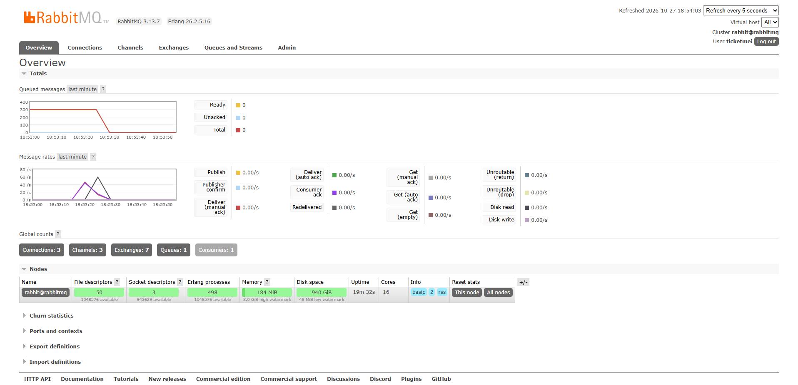
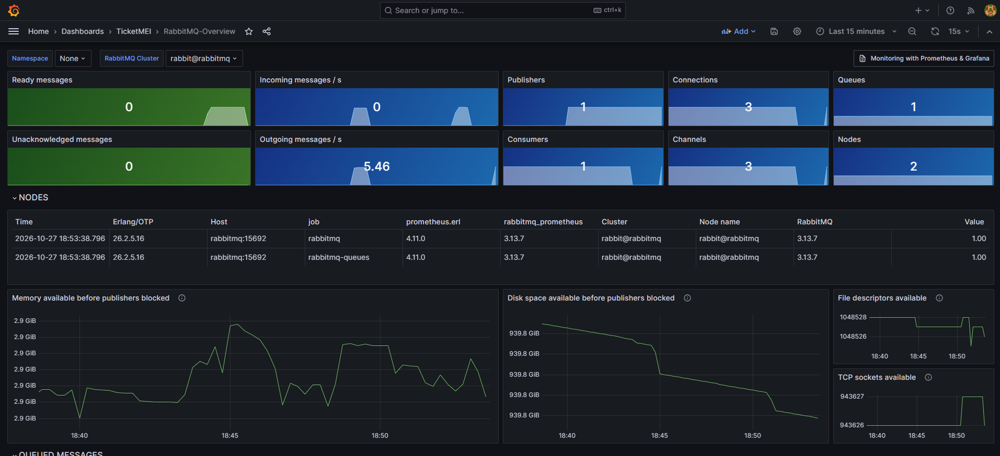
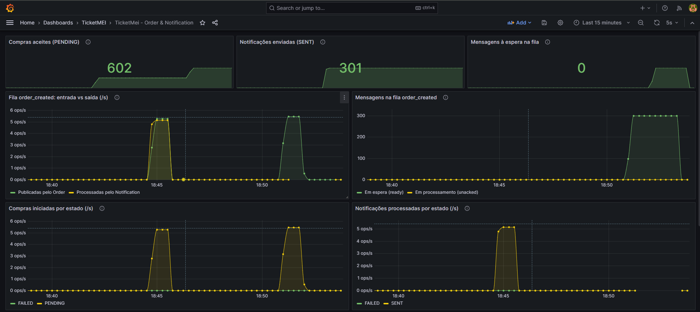
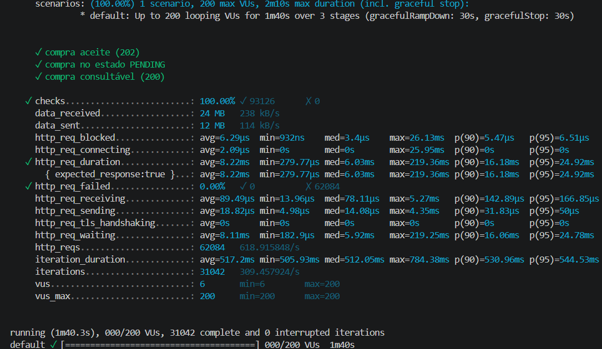
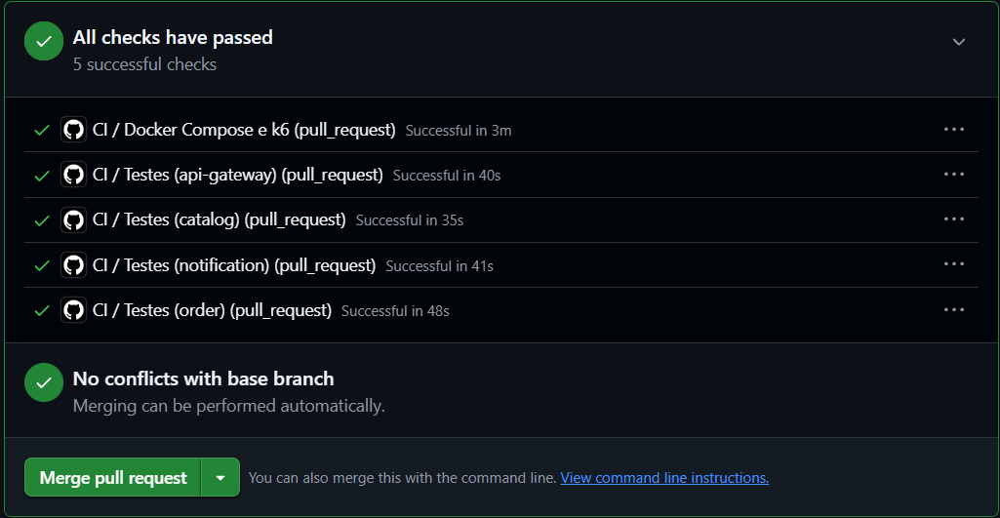

# TicketMEI

```markdown
[](https://github.com/JoaoPSVieira/SD-Ticketmei/actions/workflows/ci.yml)
```

Plataforma eletrónica de venda de bilhetes para eventos, baseada em microsserviços.
Projeto da unidade curricular de **Sistemas Distribuídos** — Mestrado em Engenharia Informática, Universidade da Madeira, 2026/2027.

## Grupo

| Nome                                | Número | GitHub                                             |
| ----------------------------------- | ------- | -------------------------------------------------- |
| João Pedro Sá Vieira              | 2103823 | [JoaoPSVieira](https://github.com/JoaoPSVieira)     |
| Francisco Guilherme Fernandes Silva | 2114821 | [SkyJust4Fun](https://github.com/SkyJust4Fun)       |
| Rodrigo Sousa Soares                | 2075526 | [SoaresRodrigo8](https://github.com/SoaresRodrigo8) |

## Estado das fases

| Fase | Prazo      | Conteúdo                                                         | Estado                          |
| ---- | ---------- | ----------------------------------------------------------------- | ------------------------------- |
| 1    | 21/10/2026 | API Gateway + Catalog, Docker Compose, Prometheus, Grafana        | Falha http_req_duration > 200ms |
| 2    | 28/10/2026 | Order + Notification, RabbitMQ                                    | Concluída                      |
| 3    | 04/11/2026 | Kubernetes, GitHub Actions + GHCR, ArgoCD, rate limiter com Redis | Por iniciar                     |

## Arquitetura (Fase 1)

## Arquitetura (Fases 1 e 2)



As linhas tracejadas são o Prometheus a recolher métricas (*scrape*) de cada componente.

- Todo o tráfego dos clientes entra pelo **API Gateway**, que encaminha os pedidos de forma **síncrona**: os eventos para o **Catalog** e as compras para o **Order**.
- O **Order** pergunta ao Catalog o preço do evento (síncrono), grava a compra como `PENDING` e publica a mensagem `OrderCreated` no **RabbitMQ**. Responde **202 Accepted** sem esperar pelo email.
- O **Notification** consome a fila `order_created` de forma **assíncrona** e simula o envio do email de confirmação.
- Cada serviço tem acesso exclusivo aos seus dados: o Catalog ao `events.json`, o Order à sua base de dados SQLite, o Notification ao seu log de entregas.
- O **Prometheus** recolhe as métricas de todos os serviços, do RabbitMQ e do cAdvisor. O **Grafana** arranca com o datasource e os dashboards configurados (provisioning).
- Todos os componentes correm em contentores, orquestrados com Docker Compose numa rede própria (`ticketmei-net`).

## Estrutura do repositório

```
.
├── .github/workflows/ci.yml      # Pipeline de CI (GitHub Actions)
├── ci/smoke-test.sh              # Smoke test do sistema completo (usado pelo CI)
├── api-gateway/                  # API Gateway (Python, FastAPI + aiohttp)
├── catalog/                      # Catalog (Python, FastAPI)
│   └── data/events.json          # Dados dos eventos (exclusivos do Catalog)
├── order/                        # Order (Python, FastAPI + SQLite + aio-pika)
├── notification/                 # Notification (Python, aio-pika)
├── prometheus/
│   └── prometheus.yml            # Configuração de scraping
├── grafana/
│   ├── provisioning/             # Datasource e provider de dashboards
│   └── dashboards/               # dashboard1.json, catalog.json, order-notification.json, rabbitmq-overview.json
├── k6/
│   ├── load-test.js              # Teste de carga dos eventos (fornecido pela docente)
│   └── orders-test.js            # Teste de carga das compras
├── docs/img/                     # Capturas de ecrã usadas neste README
├── docker-compose.yml
└── README.md
```

## Como correr

Requisitos: [Docker Desktop](https://www.docker.com/products/docker-desktop/) com Docker Compose v2.

```bash
# Construir e arrancar todos os serviços
docker compose up --build -d

# Ver o estado dos contentores (catalog e api-gateway devem ficar "healthy")
docker compose ps

# Ver logs de um serviço
docker compose logs -f api-gateway

# Parar tudo
docker compose down
```

O API Gateway só arranca depois de o healthcheck do Catalog passar, e o k6 só começa depois de o Gateway estar pronto.

| Serviço                 | URL                                                                |
| ------------------------ | ------------------------------------------------------------------ |
| API Gateway              | http://localhost:8000 (documentação: http://localhost:8000/docs) |
| Catalog                  | http://localhost:8001 (documentação: http://localhost:8001/docs) |
| Order                    | http://localhost:8002 (documentação: http://localhost:8002/docs) |
| Notification             | http://localhost:8003/metrics                                      |
| RabbitMQ (interface web) | http://localhost:15672 (ticketmei / ticketmei)                     |
| RabbitMQ (métricas)     | http://localhost:15692/metrics                                     |
| Prometheus               | http://localhost:9090                                              |
| Grafana                  | http://localhost:3000 (admin / admin)                              |
| cAdvisor                 | http://localhost:8080                                              |


## Endpoints

### API Gateway (porta 8000)

| Método | Endpoint         | Descrição                                                    |
| ------- | ---------------- | -------------------------------------------------------------- |
| GET     | `/events`      | Lista todos os eventos (encaminha para o Catalog)              |
| GET     | `/events/{id}` | Detalhes de um evento (encaminha para o Catalog)               |
| POST    | `/orders`      | Cria uma compra de bilhetes (encaminha para o Order)           |
| GET     | `/orders/{id}` | Detalhes de uma compra (encaminha para o Order)                |
| GET     | `/health`      | Estado do próprio Gateway (não depende dos outros serviços) |
| GET     | `/metrics`     | Métricas no formato Prometheus                                |
| GET     | `/docs`        | Documentação interativa da API (Swagger UI)                  |

Comportamento quando um serviço falha:

| Situação                                                           | Resposta do Gateway                                                                                                  |
| -------------------------------------------------------------------- | -------------------------------------------------------------------------------------------------------------------- |
| O serviço responde 2xx ou 4xx (ex.: 202, 404, 422)                  | A mesma resposta, sem alterações                                                                                   |
| O serviço responde 502, 503 ou 504                                  | A mesma resposta: é o próprio serviço a explicar o que falhou (ex.: o Order responde 503 com a compra `FAILED`) |
| O serviço responde outro 5xx (ex.: 500, um erro inesperado)         | `502 Bad Gateway`                                                                                                  |
| O serviço está inacessível (contentor parado, ligação recusada) | `502 Bad Gateway`                                                                                                  |
| O serviço não responde a tempo                                     | `504 Gateway Timeout`                                                                                              |

Configuração (variáveis de ambiente):

| Variável                    | Por omissão                               | Descrição                                                                                                              |
| ---------------------------- | ------------------------------------------ | ------------------------------------------------------------------------------------------------------------------------ |
| `CATALOG_URL`              | `http://localhost:8001`                  | Endereço do Catalog (no Compose: `http://catalog:8001`)                                                               |
| `ORDER_URL`                | `http://localhost:8002`                  | Endereço do Order (no Compose: `http://order:8002`)                                                                   |
| `CATALOG_TIMEOUT_SECONDS`  | `2`                                      | Tempo máximo à espera do Catalog                                                                                       |
| `ORDER_TIMEOUT_SECONDS`    | `5`                                      | Tempo máximo à espera do Order. É maior do que o do Catalog porque o Order, lá dentro, chama o Catalog e o RabbitMQ. |
| `UPSTREAM_MAX_CONNECTIONS` | `100`                                    | Ligações TCP reutilizáveis para cada serviço, por processo                                                           |
| `WEB_CONCURRENCY`          | `4` (no contentor)                       | Número de processos do Gateway                                                                                          |
| `PROMETHEUS_MULTIPROC_DIR` | `/tmp/prometheus-metrics` (no contentor) | Pasta onde cada processo guarda as suas métricas, somadas no `/metrics`                                               |

### Order (porta 8002)

| Método | Endpoint         | Descrição                                                                             |
| ------- | ---------------- | --------------------------------------------------------------------------------------- |
| POST    | `/orders`      | Cria uma compra no estado `PENDING` e publica a mensagem `OrderCreated` no RabbitMQ |
| GET     | `/orders/{id}` | Detalhes de uma compra (404 se não existir)                                            |
| GET     | `/health`      | Estado do serviço e da ligação ao RabbitMQ                                           |
| GET     | `/metrics`     | Métricas no formato Prometheus                                                         |
| GET     | `/docs`        | Documentação interativa da API (Swagger UI)                                           |

Pedido `POST /orders`:

```json
{"customer_id": "cliente-1", "customer_email": "ana@exemplo.pt", "event_id": "evt-101", "quantity": 2}
```

| Resposta          | Quando                                                                                                                                                                              |
| ----------------- | ----------------------------------------------------------------------------------------------------------------------------------------------------------------------------------- |
| `202 Accepted`  | Compra registada como `PENDING` e mensagem publicada. O corpo tem a compra (`id`, `total_amount`, `status`, `created_at`, ...) e o cabeçalho `Location: /orders/{id}`. |
| `422`           | Campos em falta ou inválidos, email inválido, `quantity` fora de 1–4 (RF2), ou evento inexistente                                                                              |
| `502` / `504` | O Catalog falhou ou não respondeu a tempo (não foi possível obter o preço)                                                                                                      |
| `503`           | O RabbitMQ está indisponível. A compra fica gravada como `FAILED`, e o corpo inclui a compra.                                                                                   |

O preço vem sempre do Catalog (`total_amount = price_eur × quantity`) e nunca do cliente. As compras ficam numa base de dados SQLite própria do Order, guardada num volume do Docker.

### Notification (porta 8003)

Não tem endpoints de negócio: consome as mensagens `OrderCreated` da fila `order_created`, simula o envio do email (100 ms) e regista cada entrega no log `/app/logs/notifications.log`, uma linha JSON por notificação, com `order_id`, `email`, `status` (`SENT` ou `FAILED`), `reason` e `timestamp`.

| Método | Endpoint     | Descrição                                   |
| ------- | ------------ | --------------------------------------------- |
| GET     | `/health`  | Estado do serviço e da ligação ao RabbitMQ |
| GET     | `/metrics` | Métricas no formato Prometheus               |

| Variável                     | Por omissão | Descrição                                                                 |
| ----------------------------- | ------------ | --------------------------------------------------------------------------- |
| `PREFETCH_COUNT`            | `10`       | Mensagens processadas em paralelo (~100 notificações/s)                   |
| `NOTIFICATION_FAILURE_RATE` | `0`        | Percentagem de envios que falham de propósito (0 a 1), para demonstração |

### Verificação rápida

```bash
curl http://localhost:8000/events
curl http://localhost:8000/events/evt-101
curl -i http://localhost:8000/events/evt-999     # 404
curl http://localhost:8000/metrics
```

No Windows, no PowerShell, usar `curl.exe` em vez de `curl`.

Compras (no PowerShell):

```powershell
$compra = Invoke-RestMethod -Method Post -Uri http://localhost:8000/orders -ContentType "application/json" `
  -Body '{"customer_id":"cliente-1","customer_email":"ana@exemplo.pt","event_id":"evt-101","quantity":2}'
$compra
Invoke-RestMethod http://localhost:8000/orders/$($compra.id)
docker compose logs notification --tail 5     # "Email de confirmação enviado para ana@exemplo.pt"
```

Ou em http://localhost:8000/docs → `POST /orders` → **Try it out**.

O smoke test do CI verifica tudo isto de uma vez (no Windows, no Git Bash): `bash ci/smoke-test.sh`.

## Comunicação assíncrona (Order → RabbitMQ → Notification)

O Order e o Notification comunicam só através da fila `order_created` do RabbitMQ. Nenhum dos dois chama o outro diretamente.

|              |                                                                                                                                        |
| ------------ | -------------------------------------------------------------------------------------------------------------------------------------- |
| Fila         | `order_created`, durável. Os dois serviços declaram-na; declarar uma fila que já existe não faz nada.                            |
| Publicação | Exchange por omissão, `routing_key="order_created"`, mensagens persistentes, `type="OrderCreated"`, `message_id` = id da compra |
| Corpo        | JSON: `type`, `order_id`, `customer_id`, `customer_email`, `event_id`, `quantity`, `total_amount`, `created_at`        |

Garantias:

| Mecanismo                               | Onde                 | O que garante                                                                                                                                                           |
| --------------------------------------- | -------------------- | ----------------------------------------------------------------------------------------------------------------------------------------------------------------------- |
| Fila durável + mensagens persistentes  | RabbitMQ             | As mensagens sobrevivem a um reinício do RabbitMQ                                                                                                                      |
| *Publisher confirms*                  | Order                | O Order só considera a compra aceite depois de o RabbitMQ confirmar que guardou a mensagem. Se a publicação falhar, a compra fica `FAILED` e o cliente recebe 503. |
| *Ack* manual, só depois de processar | Notification         | Se o Notification for abaixo a meio, as mensagens não confirmadas voltam para a fila e são entregues de novo                                                          |
| *Prefetch*                            | Notification         | No máximo `PREFETCH_COUNT` mensagens em processamento de cada vez                                                                                                    |
| Religação automática                 | Order e Notification | Se o RabbitMQ reiniciar, os dois voltam a ligar sozinhos                                                                                                                |

A entrega é **at-least-once**: nenhuma notificação se perde, mas, se o Notification falhar no instante entre enviar o email e confirmar a mensagem, esse email pode repetir-se. Quando o Order produz compras mais depressa do que o Notification as consegue tratar, a fila cresce e depois esvazia. É a fila a absorver picos sem afetar o tempo de resposta das compras.



## Observabilidade

### Métricas expostas

| Serviço     | Métrica                                                                                         | Tipo      | Labels                                    |
| ------------ | ------------------------------------------------------------------------------------------------ | --------- | ----------------------------------------- |
| API Gateway  | `gateway_requests_total`                                                                       | Counter   | `method`, `endpoint`, `http_status` |
| API Gateway  | `gateway_request_duration_seconds`                                                             | Histogram | `endpoint`                              |
| Catalog      | `catalog_requests_total`                                                                       | Counter   | `endpoint`, `http_status`             |
| Catalog      | `catalog_request_duration_seconds`                                                             | Histogram | —                                        |
| cAdvisor     | `container_cpu_usage_seconds_total`, `container_memory_usage_bytes`, ...                     | —        | `name` (nome do contentor), ...         |
| Order        | `orders_initiated_total`                                                                       | Counter   | `status` (`PENDING`, `FAILED`)      |
| Order        | `order_requests_total`                                                                         | Counter   | `method`, `endpoint`, `http_status` |
| Order        | `order_request_duration_seconds`                                                               | Histogram | `endpoint`                              |
| Notification | `notifications_processed_total`                                                                | Counter   | `status` (`SENT`, `FAILED`)         |
| Notification | `notification_processing_duration_seconds`                                                     | Histogram | —                                        |
| RabbitMQ     | `rabbitmq_detailed_queue_messages_ready`, `..._unacked` (tamanho da fila) e métricas gerais | —        | `queue`, ...                            |

- O label `endpoint` guarda o template da rota (`/events`, `/events/{event_id}`) e não o caminho real, para que cada id não crie uma série temporal nova (cardinalidade controlada). Caminhos inexistentes ficam agrupados em `unmatched`.
- Os pedidos a `/metrics` e `/health` não são contabilizados, para que as métricas reflitam apenas tráfego de clientes.
- Os buckets do histograma do Gateway estão concentrados à volta dos 200 ms (o threshold do teste de carga), para que o p95/p99 calculado seja preciso nessa zona. Os do Catalog estão abaixo de 100 ms, porque o Catalog responde a partir de memória.

### Prometheus

O Prometheus faz *scrape* (pull) de 5 em 5 segundos dos targets definidos em `prometheus/prometheus.yml`: `api-gateway:8000`, `catalog:8001`, `order:8002`, `notification:8003`, `cadvisor:8080` e o RabbitMQ (`rabbitmq:15692`) em dois jobs: `rabbitmq` (métricas gerais, em `/metrics`) e `rabbitmq-queues` (métricas por fila, em `/metrics/detailed`). O plugin de métricas do RabbitMQ vem ativo na imagem oficial.

Em http://localhost:9090/targets os três targets devem aparecer como **UP**:


### Grafana

O Grafana é configurado por ficheiros (*provisioning*), montados no contentor pelo `docker-compose.yml`:

| Ficheiro                                            | Função                                                                                                    |
| --------------------------------------------------- | ----------------------------------------------------------------------------------------------------------- |
| `grafana/provisioning/datasources/prometheus.yml` | Cria o datasource Prometheus (`http://prometheus:9090`) com o `uid` usado pelos painéis dos dashboards |
| `grafana/provisioning/dashboards/dashboards.yml`  | Carrega automaticamente todos os dashboards de `grafana/dashboards/` para a pasta **TicketMEI**     |

Dashboards:

**TicketMei - P1** (`dashboard1.json`, fornecido pela docente): monitoriza o Gateway segundo o método RED (*Rate, Errors, Duration*) e os recursos dos contentores.

| Painel                          | Query                                                                                        | O que mostra                                       |
| ------------------------------- | -------------------------------------------------------------------------------------------- | -------------------------------------------------- |
| Gateway Throughput (RPS)        | `sum(rate(gateway_requests_total[1m]))`                                                    | Pedidos por segundo recebidos pelo Gateway         |
| API Gateway Latency (p95 & p99) | `histogram_quantile(0.95, sum(rate(gateway_request_duration_seconds_bucket[1m])) by (le))` | Tempo abaixo do qual ficam 95% (e 99%) dos pedidos |
| Gateway HTTP Error Rate (%)     | pedidos `5xx` / total × 100                                                               | Percentagem de pedidos com erro do servidor        |
| CPU Usage by Container          | `rate(container_cpu_usage_seconds_total{name=~"api-gateway\|catalog"}[1m]) * 100`           | CPU usado por cada contentor (100% = um core)      |
| Memory Consumption              | `container_memory_usage_bytes{name=~"api-gateway\|catalog"}`                                | Memória usada por cada contentor                  |

**TicketMei - Catalog** (`catalog.json`): métricas específicas do Catalog.

| Painel                                | O que mostra                                                                               |
| ------------------------------------- | ------------------------------------------------------------------------------------------ |
| Catalog Throughput (RPS) por endpoint | Pedidos por segundo por rota                                                               |
| Catalog respostas por código HTTP    | Pedidos por segundo por código (200, 404, ...)                                            |
| Catalog Latency (p95 & p99)           | Tempo de resposta medido dentro do Catalog                                                 |
| Latência p95: Gateway vs Catalog     | A diferença entre as duas linhas é o tempo gasto no Gateway e na rede entre os serviços |

**TicketMei - Order & Notification** (`order-notification.json`): compras, fila e notificações.

| Painel                                                                                        | O que mostra                                                                                                      |
| --------------------------------------------------------------------------------------------- | ----------------------------------------------------------------------------------------------------------------- |
| Compras aceites / Notificações enviadas / Mensagens à espera                               | Totais no intervalo do dashboard e o tamanho atual da fila                                                        |
| Fila order_created: entrada vs saída                                                         | Compras publicadas pelo Order vs notificações processadas. Se a entrada estiver acima da saída, a fila cresce. |
| Mensagens na fila order_created                                                               | Mensagens em espera (*ready*) e em processamento (*unacked*), medidas pelo RabbitMQ                           |
| Compras iniciadas por estado                                                                  | `orders_initiated_total` por `PENDING` / `FAILED`                                                           |
| Notificações processadas por estado                                                         | `notifications_processed_total` por `SENT` / `FAILED`                                                       |
| Latência de POST /orders (p95 & p99) e tempo de processamento das notificações (p50 & p95) |                                                                                                                   |
| Respostas HTTP do Order por código e CPU por contentor                                       |                                                                                                                   |

**RabbitMQ-Overview** (`rabbitmq-overview.json`): o dashboard oficial do RabbitMQ (grafana.com, ID 10991), na versão do RabbitMQ 3.13.7, ligado ao datasource do projeto.





Todas as queries usam uma janela de 1 minuto (`[1m]`), por isso os gráficos reagem a mudanças com um atraso de até um minuto.

## Teste de carga (k6)

O k6 está no profile `testing`, por isso não arranca com `docker compose up`:

```bash
docker compose run --rm k6
```

O teste (`k6/load-test.js`) sobe até 500 utilizadores virtuais em 3 minutos, mantém durante 2 minutos e desce em 30 segundos. Cada utilizador faz `GET /events` ao Gateway e espera 100 ms, em ciclo.
Thresholds: p95 da latência < 200 ms e menos de 1% de pedidos falhados.

### Resultados

| Métrica         | Resultado                       |
| ---------------- | ------------------------------- |
| Pedidos totais   | 512747                          |
| Débito médio   | 1553.59 pedidos/s               |
| Latência p90    | 233.61 ms                       |
| Latência p95    | 526.3 ms (threshold: < 200 ms)  |
| Pedidos falhados | 0.00 % (threshold: < 1%)        |
| Máquina         | Laptop Ryzen 7 7735HS, 16 Cores |


### Compras (`k6/orders-test.js`)

```bash
docker compose run --rm k6 run orders-test.js
```

Cada utilizador virtual cria uma compra através do Gateway (`POST /orders`) e consulta-a logo a seguir (`GET /orders/{id}`). Sobe até 50 utilizadores em 1 minuto, mantém durante 2 minutos e desce em 30 segundos, com 0,5 s entre compras (~100 compras/s, perto da capacidade do Notification). Thresholds: p95 < 200 ms, menos de 1% de pedidos falhados e mais de 99% das verificações certas.

Para mais carga, e para ver a fila do RabbitMQ a crescer e a esvaziar no dashboard:

```bash
docker compose run --rm k6 run --stage 30s:200,60s:200,10s:0 orders-test.js
```

| Métrica                                            | Resultado                          |
| --------------------------------------------------- | ---------------------------------- |
| Pedidos totais (POST + GET)                         | 62084                              |
| Compras criadas                                     | 31042                              |
| Latência p95 (threshold: < 200 ms)                 | 24.92 ms                           |
| Pedidos falhados (threshold: < 1%)                  | 0.00 %                             |
| Compras na base de dados = notificações enviadas? | Sim (47 Mil (Realizados 2 Testes)) |



## Demonstração de falha

Com tráfego a passar pelo Gateway (por exemplo, durante o teste k6):

```bash
docker stop catalog     # o Gateway passa a responder 502 e a taxa de erros sobe no dashboard
docker start catalog    # o Gateway volta a responder 200 sem ser reiniciado
```

O Gateway continua `healthy` enquanto o Catalog está em baixo, porque o seu `/health` não depende do Catalog. Isto evita falhas em cascata (o Gateway ser reiniciado sem estar avariado).


Fase 2:

| Ação                                       | Resultado                                                                                                                      |
| -------------------------------------------- | ------------------------------------------------------------------------------------------------------------------------------ |
| `docker stop notification` e fazer compras | As compras continuam a ser aceites (202). As mensagens ficam à espera na fila e o painel "Mensagens na fila" sobe.            |
| `docker start notification`                | A fila esvazia e todas as compras recebem o email. Nenhuma se perde.                                                           |
| `docker stop rabbitmq` e fazer uma compra  | `503`, compra `FAILED`. O Order e o Notification continuam `healthy`, com `"rabbitmq": "disconnected"` no `/health`. |
| `docker start rabbitmq`                    | O Order e o Notification voltam a ligar sozinhos e as compras voltam a dar 202                                                 |
| `docker stop order` e fazer uma compra     | `502` do Gateway. Os eventos (`GET /events`) continuam a funcionar.                                                        |
| `docker compose restart order`             | As compras anteriores continuam disponíveis (base de dados num volume)                                                        |

## Decisões técnicas

- **Python com FastAPI e uvicorn** nos dois serviços.
- **`aiohttp` como cliente HTTP no Gateway.** Num teste com o script k6 e 500 utilizadores virtuais, o `httpx` ficou em 261 pedidos/s com p95 de 4,6 s; o `aiohttp` chegou aos 2 118 pedidos/s com p95 de 174 ms, na mesma máquina.
- **Uma única sessão HTTP com pool de ligações (keep-alive)** entre o Gateway e o Catalog, criada no arranque do Gateway, em vez de uma ligação nova por pedido.
- **Timeout de 2 s** nas chamadas ao Catalog. Um Catalog bloqueado nunca prende o Gateway indefinidamente.
- **Um só processo por contentor.** As métricas do `prometheus_client` vivem na memória do processo. Com vários processos, cada um teria contadores diferentes. Para escalar usam-se réplicas (Fase 3).
- **O Catalog lê e valida o `events.json` uma vez no arranque** e guarda as respostas já serializadas em JSON. Os dados são estáticos e cada pedido só devolve bytes prontos.
- **Healthchecks e `depends_on: condition: service_healthy`** para uma ordem de arranque correta.
- **Contentores com utilizador sem privilégios** e imagens `python:3.13-slim`.
- **Fase 2: SQLite para as compras**, num volume do Docker. Não precisa de mais um contentor e aguenta os 2 processos do Order em simultâneo (modo WAL). Limitação: o Order não pode ter várias réplicas.
- **Fase 2: o preço vem do Catalog** (pedido síncrono do Order ao Catalog), nunca do cliente.
- **Fase 2: `aio-pika` para o RabbitMQ**, com religação automática, *publisher confirms* no Order e *ack* manual com *prefetch* no Notification.
- **Fase 2: a compra é gravada antes de publicar a mensagem.** Se a publicação falhar, fica `FAILED` (503). Limitação conhecida: se o Order morrer exatamente entre gravar e publicar, a compra fica `PENDING` sem mensagem (*dual write*). A solução seria o padrão *Transactional Outbox*.
- **Fase 2: o Gateway passa as respostas 502/503/504 dos serviços tal como vêm**, porque são o serviço a explicar o que falhou. Só um 500 (erro inesperado) é convertido em 502.
- **Pipeline de CI (GitHub Actions)**: testes de todos os serviços (com um RabbitMQ verdadeiro), build das imagens, arranque do Compose, smoke test e testes k6 com carga reduzida.

## Integração contínua (GitHub Actions)

O pipeline `.github/workflows/ci.yml` corre em cada push para o `main`, em cada Pull Request e à mão (separador **Actions** → **CI** → **Run workflow**):

1. **Testes**: um job por serviço (Catalog, API Gateway, Order, Notification), com um RabbitMQ verdadeiro para os testes de integração.
2. **Docker Compose e k6**, só se os testes passarem:
   - valida o `docker-compose.yml` e constrói as imagens;
   - arranca os serviços e espera que fiquem `healthy`;
   - corre o smoke test (`ci/smoke-test.sh`): eventos, compras, notificação e targets do Prometheus;
   - corre os dois testes k6 com carga reduzida (as máquinas do GitHub Actions são pequenas e partilhadas). Os thresholds dos scripts continuam a aplicar-se.
   - se algum passo falhar, mostra os logs dos serviços.



## Desenvolvimento local (sem Docker)

Cada serviço Python pode ser corrido e testado diretamente. Exemplo para o Catalog, no Windows:

```bat
cd catalog
python -m venv .venv
.venv\Scripts\activate
pip install -r requirements-dev.txt

rem Correr os testes
python -m pytest

rem Arrancar em modo de desenvolvimento (recarrega ao gravar)
uvicorn main:app --port 8001 --reload
```

Em Linux/macOS, a ativação do ambiente é `source .venv/bin/activate`.

O API Gateway segue os mesmos passos, na pasta `api-gateway/` e na porta 8000. Por omissão procura o Catalog em `http://localhost:8001`, por isso basta ter o Catalog a correr ao mesmo tempo. Os testes do Gateway não precisam do Catalog: usam um Catalog simulado.

## Resolução de problemas

| Sintoma                                                  | Causa provável e solução                                                                                                                                 |
| -------------------------------------------------------- | ----------------------------------------------------------------------------------------------------------------------------------------------------------- |
| Painéis do Grafana com "datasource not found"           | O provisioning não foi carregado. Ver `docker compose logs grafana` e confirmar que as pastas `grafana/provisioning` e `grafana/dashboards` existem. |
| Painéis do Gateway sem dados                            | Ver http://localhost:9090/targets. Se o `api-gateway` estiver DOWN, ver `docker compose logs api-gateway`.                                              |
| Painel de erros mostra "NaN" ou "No data"                | Normal quando não há tráfego: a query divide pelo total de pedidos, que é zero.                                                                         |
| Painéis de CPU e memória vazios                        | O cAdvisor não está a identificar os contentores. Ver http://localhost:8080 e `docker compose logs cadvisor`.                                           |
| `api-gateway` fica em `Created`                      | Está à espera de o Catalog ficar `healthy`. Ver `docker compose logs catalog`.                                                                        |
| `port is already allocated`                            | Outro processo está a usar a porta (por exemplo, um `uvicorn` local). Pará-lo antes de `docker compose up`.                                           |
| `order` ou `notification` ficam em `Created`       | Estão à espera de o `rabbitmq` ficar `healthy` (até 30 s no primeiro arranque)                                                                       |
| Todas as compras dão `503`                            | O Order não está ligado ao RabbitMQ: ver `curl http://localhost:8002/health` e `docker compose logs order`                                            |
| A fila `order_created` não esvazia                    | Ver se o Notification está ligado (`/health`) e se a fila tem 1 consumidor na interface do RabbitMQ                                                      |
| `PermissionError` nos logs do Order ou do Notification | O volume foi criado com permissões erradas: `docker compose down -v` (**apaga as compras e o log de entregas**) e `docker compose up --build -d` |
| Pipeline de CI vermelho                                  | Abrir o job que falhou no separador **Actions**. No job "Docker Compose e k6", o último passo mostra os logs de todos os serviços.                  |

## Fase 3: Kubernetes e Argo CD

A partir da Fase 3, todos os componentes correm no Kubernetes do Docker Desktop (RNF1). O `docker-compose.yml` continua no repositório para o desenvolvimento local e para o pipeline de CI.

### Recursos no cluster (namespace `ticketmei`)

| Ficheiro                  | Recursos                                             | Notas                                                                   |
| ------------------------- | ---------------------------------------------------- | ----------------------------------------------------------------------- |
| `k8s/00-base.yaml`      | Namespace, Secret `rabbitmq-credentials`           | Credenciais do RabbitMQ partilhadas pelo RabbitMQ, Order e Notification |
| `k8s/rabbitmq.yaml`     | PVC, Deployment (`Recreate`), Service LoadBalancer | Filas e mensagens persistentes sobrevivem a reinícios                  |
| `k8s/redis.yaml`        | Deployment, Service                                  | Contadores do rate limiter do Gateway (sem disco)                       |
| `k8s/catalog.yaml`      | Deployment, Service                                  |                                                                         |
| `k8s/order.yaml`        | PVC, Deployment, Service                             | Base de dados SQLite no disco persistente                               |
| `k8s/notification.yaml` | PVC, Deployment, Service                             | Log de entregas no disco persistente                                    |
| `k8s/api-gateway.yaml`  | Deployment, Service LoadBalancer                     | Única entrada dos clientes: http://localhost:8000                      |

Todos os serviços têm *readiness* e *liveness probes* no `/health`, pedidos e limites de memória, e *rolling updates* sem interrupção (`maxUnavailable: 0`).

### GitOps com Argo CD

O Argo CD vigia a pasta `k8s/` do ramo `main` (`argocd/application.yaml`) e aplica cada alteração automaticamente (`automated`), apaga o que for removido do Git (`prune`) e desfaz alterações feitas à mão no cluster (`selfHeal`). Não se faz `kubectl apply` no cluster da demonstração: muda-se o Git.

Instalação (uma vez):

```powershell
kubectl create namespace argocd
kubectl apply -n argocd --server-side --force-conflicts -f https://raw.githubusercontent.com/argoproj/argo-cd/stable/manifests/install.yaml
kubectl apply -f argocd/application.yaml
kubectl port-forward svc/argocd-server -n argocd 8443:443   # interface em https://localhost:8443
```

### Testes de carga no cluster

```powershell
.\k8s-tools\k6.ps1 eventos   # GET /events, até 500 utilizadores virtuais
.\k8s-tools\k6.ps1 compras   # POST e GET /orders, 50 utilizadores virtuais
```

O k6 corre num Job dentro do cluster e usa o endereço interno `http://api-gateway:8000`, tal como na rede do compose.

### Correr sem o Argo CD (desenvolvimento)

```powershell
docker compose down
.\k8s-tools\build-local-images.ps1
kubectl apply -f k8s/ --recursive
kubectl get pods -n ticketmei
```

### Monitorização no Kubernetes (Prometheus, Grafana e cAdvisor)

O Prometheus, o Grafana e o cAdvisor também correm no cluster (`k8s/monitoring/`), com as mesmas versões e **os mesmos ficheiros de configuração** do compose:

| Componente      | Recursos                            | No PC                                                          |
| --------------- | ----------------------------------- | -------------------------------------------------------------- |
| Prometheus 2.50 | Deployment, Service LoadBalancer    | http://localhost:9090 (*Status* → *Targets*)              |
| Grafana 10.3    | Deployment, Service LoadBalancer    | http://localhost:3000 (admin/admin), pasta **TicketMEI** |
| cAdvisor        | DaemonSet (um pod por nó), Service | só dentro do cluster (`cadvisor:8080`)                      |

Os ficheiros `prometheus/prometheus.yml`, `grafana/provisioning/` e `grafana/dashboards/` chegam aos pods por ConfigMaps, gerados com:

```powershell
python k8s-tools/gerar-configmaps.py
```

Para mudar um dashboard ou um alvo do Prometheus, altera-se o ficheiro original, corre-se o script e faz-se commit dos dois. O `k8s/monitoring/configmaps.yaml` nunca se edita à mão, e o CI falha se não estiver em dia. O script escreve também um resumo (hash) da configuração nos Deployments do Prometheus e do Grafana, para que uma configuração nova reinicie o pod.

**cAdvisor no Kubernetes.** No Kubernetes do Docker Desktop, os pods são contentores Docker com nomes do tipo `k8s_catalog_catalog-7c8b..._ticketmei_...` e com as labels `io.kubernetes.*`. Uma regra de *relabeling* no job `cadvisor` do Prometheus põe na label `name` só o nome do contentor (`catalog`). Assim, os painéis de CPU e memória das fases 1 e 2 funcionam no compose e no Kubernetes sem alterações.

**Dashboard TicketMei - Kubernetes** (novo): alvos do Prometheus em cima e em baixo, pods a correr por serviço (num *rolling update* vê-se o serviço com 2 pods durante alguns segundos), CPU e memória por pod, e pedidos de compra aceites e rejeitados pelo rate limiter (429).
