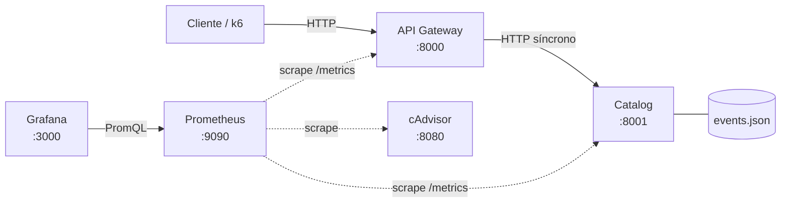
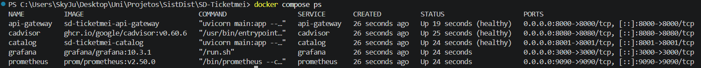
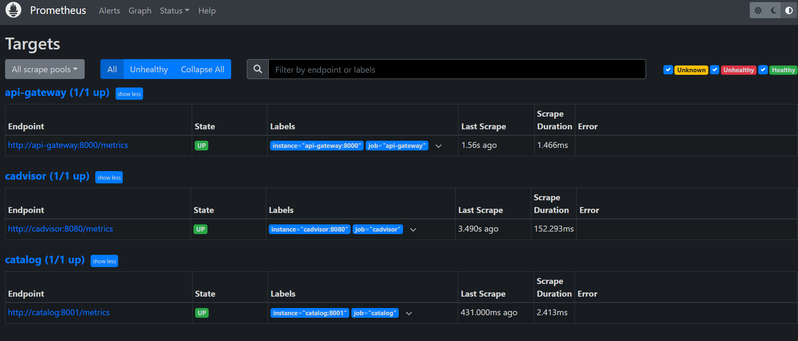
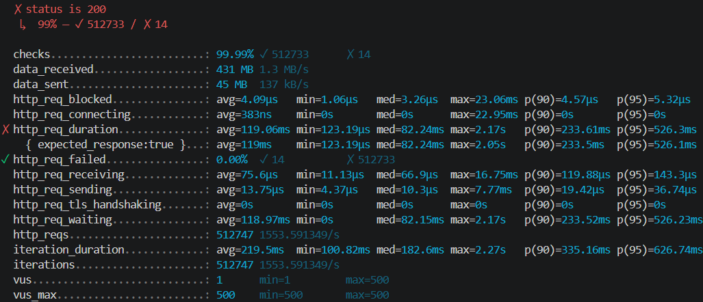
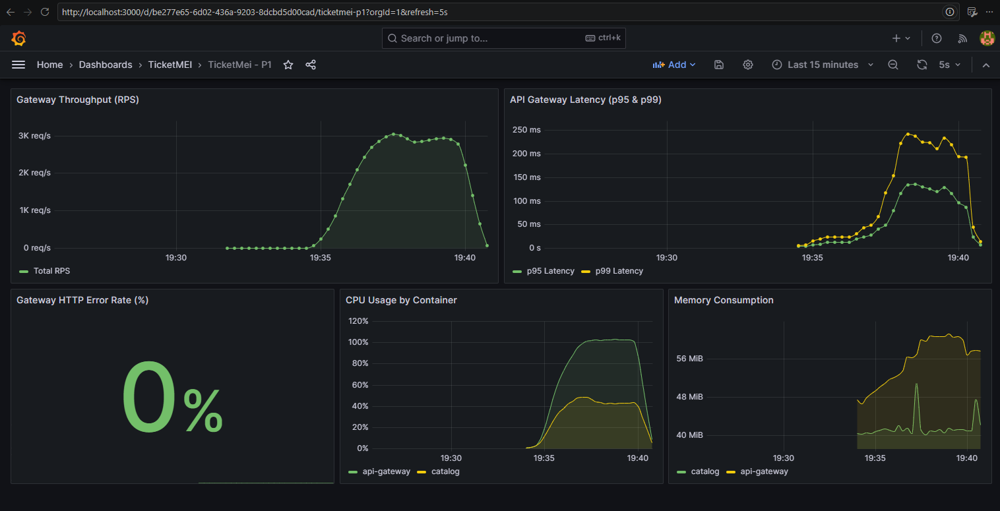
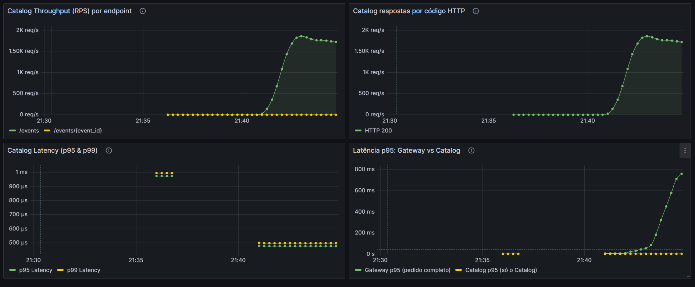
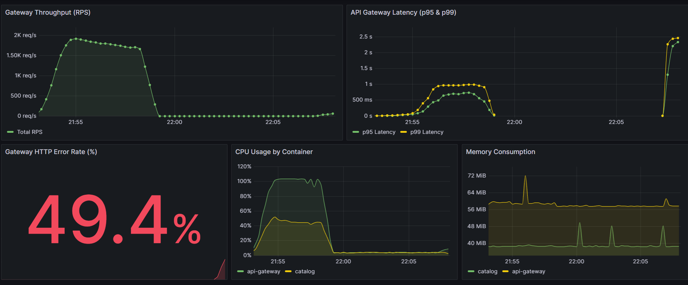

# TicketMEI

Plataforma eletrónica de venda de bilhetes para eventos, baseada em microsserviços.
Projeto da unidade curricular de **Sistemas Distribuídos** — Mestrado em Engenharia Informática, Universidade da Madeira, 2026/2027.

## Grupo

| Nome                                | Número | GitHub                                             |
| ----------------------------------- | ------- | -------------------------------------------------- |
| João Pedro Sá Vieira                | 2103823 | [JoaoPSVieira](https://github.com/JoaoPSVieira)     |
| Francisco Guilherme Fernandes Silva | 2114821 | [SkyJust4Fun](https://github.com/SkyJust4Fun)       |
| Rodrigo Sousa Soares                | 2075526 | [SoaresRodrigo8](https://github.com/SoaresRodrigo8) |


## Estado das fases

| Fase | Prazo      | Conteúdo                                                         | Estado      |
| ---- | ---------- | ----------------------------------------------------------------- | ----------- |
| 1    | 21/10/2026 | API Gateway + Catalog, Docker Compose, Prometheus, Grafana        | Em curso    |
| 2    | 28/10/2026 | Order + Notification, RabbitMQ                                    | Por iniciar |
| 3    | 04/11/2026 | Kubernetes, GitHub Actions + GHCR, ArgoCD, rate limiter com Redis | Por iniciar |

## Arquitetura (Fase 1)



- Todo o tráfego dos clientes entra pelo **API Gateway**, que encaminha os pedidos de eventos para o **Catalog** de forma síncrona.
- O **Catalog** é o único serviço com acesso aos dados dos eventos (`catalog/data/events.json`).
- O **Prometheus** recolhe métricas de 5 em 5 segundos do endpoint `/metrics` de cada serviço e do **cAdvisor** (CPU e memória de cada contentor).
- O **Grafana** arranca já com o datasource e os dashboards configurados (provisioning), sem passos manuais.
- Todos os componentes correm em contentores, orquestrados com Docker Compose numa rede própria (`ticketmei-net`).

## Estrutura do repositório

```
.
├── api-gateway/                  # Serviço API Gateway (Python, FastAPI + aiohttp)
│   ├── main.py
│   ├── Dockerfile
│   └── tests/                    # Testes com um Catalog simulado
├── catalog/                      # Serviço Catalog (Python, FastAPI)
│   ├── main.py
│   ├── Dockerfile
│   ├── data/events.json          # Dados dos eventos (exclusivos do Catalog)
│   └── tests/
├── prometheus/
│   └── prometheus.yml            # Configuração de scraping
├── grafana/
│   ├── provisioning/             # Datasource e provider de dashboards
│   └── dashboards/               # dashboard1.json, catalog.json
├── k6/
│   └── load-test.js              # Teste de carga
├── docs/img/                     # Capturas de ecrã usadas neste README
├── docker-compose.yml
└── README.md
```

## Como correr

Requisitos: [Docker Desktop](https://www.docker.com/products/docker-desktop/) com Docker Compose v2.

```bash
# Construir e arrancar todos os serviços
docker compose up --build -d

# Ver o estado dos contentores (catalog e api-gateway devem ficar "healthy")
docker compose ps

# Ver logs de um serviço
docker compose logs -f api-gateway

# Parar tudo
docker compose down
```

O API Gateway só arranca depois de o healthcheck do Catalog passar, e o k6 só começa depois de o Gateway estar pronto.

| Serviço | URL |
|---------|-----|
| API Gateway | http://localhost:8000 (documentação: http://localhost:8000/docs) |
| Catalog | http://localhost:8001 (documentação: http://localhost:8001/docs) |
| Prometheus | http://localhost:9090 |
| Grafana | http://localhost:3000 (admin / admin) |
| cAdvisor | http://localhost:8080 |



## Endpoints

### API Gateway (porta 8000)

| Método | Endpoint | Descrição |
|--------|----------|-----------|
| GET | `/events` | Lista todos os eventos (encaminha para o Catalog) |
| GET | `/events/{id}` | Detalhes de um evento (encaminha para o Catalog) |
| GET | `/health` | Estado do próprio Gateway (não depende do Catalog) |
| GET | `/metrics` | Métricas no formato Prometheus |
| GET | `/docs` | Documentação interativa da API (Swagger UI) |

Comportamento quando o Catalog falha:

| Situação | Resposta do Gateway |
|----------|---------------------|
| Catalog responde 2xx ou 4xx (ex.: 404) | A mesma resposta, sem alterações |
| Catalog responde 5xx | `502 Bad Gateway` |
| Catalog inacessível (contentor parado, ligação recusada) | `502 Bad Gateway` |
| Catalog não responde dentro de `CATALOG_TIMEOUT_SECONDS` | `504 Gateway Timeout` |

Configuração (variáveis de ambiente):

| Variável | Por omissão | Descrição |
|----------|-------------|-----------|
| `CATALOG_URL` | `http://localhost:8001` | Endereço do Catalog (no Compose: `http://catalog:8001`) |
| `CATALOG_TIMEOUT_SECONDS` | `2` | Tempo máximo à espera do Catalog |
| `CATALOG_MAX_CONNECTIONS` | `100` | Ligações TCP reutilizáveis para o Catalog |

### Catalog (porta 8001)

| Método | Endpoint | Descrição |
|--------|----------|-----------|
| GET | `/events` | Lista todos os eventos |
| GET | `/events/{id}` | Detalhes de um evento (404 se não existir) |
| GET | `/health` | Estado do serviço (usado pelo healthcheck do Docker) |
| GET | `/metrics` | Métricas no formato Prometheus |
| GET | `/docs` | Documentação interativa da API (Swagger UI) |

### Verificação rápida

```bash
curl http://localhost:8000/events
curl http://localhost:8000/events/evt-101
curl -i http://localhost:8000/events/evt-999     # 404
curl http://localhost:8000/metrics
```

No Windows, no PowerShell, usar `curl.exe` em vez de `curl`.

## Observabilidade

### Métricas expostas

| Serviço | Métrica | Tipo | Labels |
|---------|---------|------|--------|
| API Gateway | `gateway_requests_total` | Counter | `method`, `endpoint`, `http_status` |
| API Gateway | `gateway_request_duration_seconds` | Histogram | `endpoint` |
| Catalog | `catalog_requests_total` | Counter | `endpoint`, `http_status` |
| Catalog | `catalog_request_duration_seconds` | Histogram | — |
| cAdvisor | `container_cpu_usage_seconds_total`, `container_memory_usage_bytes`, ... | — | `name` (nome do contentor), ... |

- O label `endpoint` guarda o template da rota (`/events`, `/events/{event_id}`) e não o caminho real, para que cada id não crie uma série temporal nova (cardinalidade controlada). Caminhos inexistentes ficam agrupados em `unmatched`.
- Os pedidos a `/metrics` e `/health` não são contabilizados, para que as métricas reflitam apenas tráfego de clientes.
- Os buckets do histograma do Gateway estão concentrados à volta dos 200 ms (o threshold do teste de carga), para que o p95/p99 calculado seja preciso nessa zona. Os do Catalog estão abaixo de 100 ms, porque o Catalog responde a partir de memória.

### Prometheus

O Prometheus faz *scrape* (pull) de três targets de 5 em 5 segundos, definidos em `prometheus/prometheus.yml`: `api-gateway:8000`, `catalog:8001` e `cadvisor:8080`. Dentro da rede do Compose, os nomes dos serviços resolvem para os IPs dos contentores.

Em http://localhost:9090/targets os três targets devem aparecer como **UP**:



### Grafana

O Grafana é configurado por ficheiros (*provisioning*), montados no contentor pelo `docker-compose.yml`:

| Ficheiro | Função |
|----------|--------|
| `grafana/provisioning/datasources/prometheus.yml` | Cria o datasource Prometheus (`http://prometheus:9090`) com o `uid` usado pelos painéis dos dashboards |
| `grafana/provisioning/dashboards/dashboards.yml` | Carrega automaticamente todos os dashboards de `grafana/dashboards/` para a pasta **TicketMEI** |

Dashboards:

**TicketMei - P1** (`dashboard1.json`, fornecido pela docente): monitoriza o Gateway segundo o método RED (*Rate, Errors, Duration*) e os recursos dos contentores.

| Painel | Query | O que mostra |
|--------|-------|--------------|
| Gateway Throughput (RPS) | `sum(rate(gateway_requests_total[1m]))` | Pedidos por segundo recebidos pelo Gateway |
| API Gateway Latency (p95 & p99) | `histogram_quantile(0.95, sum(rate(gateway_request_duration_seconds_bucket[1m])) by (le))` | Tempo abaixo do qual ficam 95% (e 99%) dos pedidos |
| Gateway HTTP Error Rate (%) | pedidos `5xx` / total × 100 | Percentagem de pedidos com erro do servidor |
| CPU Usage by Container | `rate(container_cpu_usage_seconds_total{name=~"api-gateway\|catalog"}[1m]) * 100` | CPU usado por cada contentor (100% = um core) |
| Memory Consumption | `container_memory_usage_bytes{name=~"api-gateway\|catalog"}` | Memória usada por cada contentor |

**TicketMei - Catalog** (`catalog.json`): métricas específicas do Catalog.

| Painel | O que mostra |
|--------|--------------|
| Catalog Throughput (RPS) por endpoint | Pedidos por segundo por rota |
| Catalog respostas por código HTTP | Pedidos por segundo por código (200, 404, ...) |
| Catalog Latency (p95 & p99) | Tempo de resposta medido dentro do Catalog |
| Latência p95: Gateway vs Catalog | A diferença entre as duas linhas é o tempo gasto no Gateway e na rede entre os serviços |

Todas as queries usam uma janela de 1 minuto (`[1m]`), por isso os gráficos reagem a mudanças com um atraso de até um minuto.

## Teste de carga (k6)

O k6 está no profile `testing`, por isso não arranca com `docker compose up`:

```bash
docker compose run --rm k6
```

O teste (`k6/load-test.js`) sobe até 500 utilizadores virtuais em 3 minutos, mantém durante 2 minutos e desce em 30 segundos. Cada utilizador faz `GET /events` ao Gateway e espera 100 ms, em ciclo.
Thresholds: p95 da latência < 200 ms e menos de 1% de pedidos falhados.

### Resultados

| Métrica | Resultado |
|---------|-----------|
| Pedidos totais | _preencher_ |
| Débito médio | _preencher_ pedidos/s |
| Latência p90 | _preencher_ ms |
| Latência p95 | _preencher_ ms (threshold: < 200 ms) |
| Pedidos falhados | _preencher_ % (threshold: < 1%) |
| Máquina | _preencher (ex.: portátil, CPU, nº de cores atribuídos ao Docker)_ |







## Demonstração de falha

Com tráfego a passar pelo Gateway (por exemplo, durante o teste k6):

```bash
docker stop catalog     # o Gateway passa a responder 502 e a taxa de erros sobe no dashboard
docker start catalog    # o Gateway volta a responder 200 sem ser reiniciado
```

O Gateway continua `healthy` enquanto o Catalog está em baixo, porque o seu `/health` não depende do Catalog. Isto evita falhas em cascata (o Gateway ser reiniciado sem estar avariado).



## Decisões técnicas

- **Python com FastAPI e uvicorn** nos dois serviços.
- **`aiohttp` como cliente HTTP no Gateway.** Num teste com o script k6 e 500 utilizadores virtuais, o `httpx` ficou em 261 pedidos/s com p95 de 4,6 s; o `aiohttp` chegou aos 2 118 pedidos/s com p95 de 174 ms, na mesma máquina.
- **Uma única sessão HTTP com pool de ligações (keep-alive)** entre o Gateway e o Catalog, criada no arranque do Gateway, em vez de uma ligação nova por pedido.
- **Timeout de 2 s** nas chamadas ao Catalog. Um Catalog bloqueado nunca prende o Gateway indefinidamente.
- **Um só processo por contentor.** As métricas do `prometheus_client` vivem na memória do processo. Com vários processos, cada um teria contadores diferentes. Para escalar usam-se réplicas (Fase 3).
- **O Catalog lê e valida o `events.json` uma vez no arranque** e guarda as respostas já serializadas em JSON. Os dados são estáticos e cada pedido só devolve bytes prontos.
- **Healthchecks e `depends_on: condition: service_healthy`** para uma ordem de arranque correta.
- **Contentores com utilizador sem privilégios** e imagens `python:3.13-slim`.

## Desenvolvimento local (sem Docker)

Cada serviço Python pode ser corrido e testado diretamente. Exemplo para o Catalog, no Windows:

```bat
cd catalog
python -m venv .venv
.venv\Scripts\activate
pip install -r requirements-dev.txt

rem Correr os testes
python -m pytest

rem Arrancar em modo de desenvolvimento (recarrega ao gravar)
uvicorn main:app --port 8001 --reload
```

Em Linux/macOS, a ativação do ambiente é `source .venv/bin/activate`.

O API Gateway segue os mesmos passos, na pasta `api-gateway/` e na porta 8000. Por omissão procura o Catalog em `http://localhost:8001`, por isso basta ter o Catalog a correr ao mesmo tempo. Os testes do Gateway não precisam do Catalog: usam um Catalog simulado.

## Resolução de problemas

| Sintoma | Causa provável e solução |
|---------|--------------------------|
| Painéis do Grafana com "datasource not found" | O provisioning não foi carregado. Ver `docker compose logs grafana` e confirmar que as pastas `grafana/provisioning` e `grafana/dashboards` existem. |
| Painéis do Gateway sem dados | Ver http://localhost:9090/targets. Se o `api-gateway` estiver DOWN, ver `docker compose logs api-gateway`. |
| Painel de erros mostra "NaN" ou "No data" | Normal quando não há tráfego: a query divide pelo total de pedidos, que é zero. |
| Painéis de CPU e memória vazios | O cAdvisor não está a identificar os contentores. Ver http://localhost:8080 e `docker compose logs cadvisor`. |
| `api-gateway` fica em `Created` | Está à espera de o Catalog ficar `healthy`. Ver `docker compose logs catalog`. |
| `port is already allocated` | Outro processo está a usar a porta (por exemplo, um `uvicorn` local). Pará-lo antes de `docker compose up`. |
